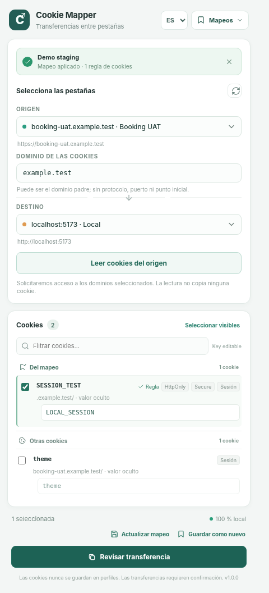

# Cookie Mapper

**Copia y renombra cookies entre pestañas de desarrollo mediante mapeos guardados y confirmación explícita.**

[Read in English](README.md) · [Privacidad](PRIVACY.es.md) · [Seguridad](SECURITY.md) · [Contribuir](CONTRIBUTING.md)

> **Solo para entornos de desarrollo o pruebas a los que tengas acceso autorizado.** Las cookies de sesión pueden otorgar acceso a cuentas. Nunca copies sesiones de otras personas ni a sitios de destino que no sean de confianza.



## Funcionalidades

- Selección de las pestañas de origen y destino en Microsoft Edge y navegadores Chromium.
- Lectura de cookies de subdominios y dominios padre, incluidas `HttpOnly` si se conceden permisos.
- Selección y renombrado de keys antes de copiar al destino.
- Mapeos reutilizables: `https://app-{env}.example.test/**` → `http://localhost:5173/**`.
- Detección y sugerencia de mapeos compatibles sin aplicarlos automáticamente.
- Cookies mapeadas al principio, respetando el orden de las reglas.
- Vista previa de sobrescrituras y confirmación explícita.
- **Castellano e inglés**, detectados según el navegador y con selector ES/EN.
- Procesamiento local; sin backend, analítica, scripts remotos ni almacenamiento de valores de cookies.

## Instalar en Edge

1. Descarga el ZIP instalable desde una [release de GitHub](../../releases) cuando esté publicada, o compílalo.
2. Descomprímelo. La carpeta debe contener `manifest.json` en su raíz.
3. Abre `edge://extensions`, activa **Modo de desarrollador**, pulsa **Cargar descomprimida** y selecciona esa carpeta.
4. Abre las pestañas y sigue el flujo **Leer → Seleccionar/Renombrar → Revisar → Confirmar**.

**Si actualizas desde la v0.6**, sustituye los archivos en la misma carpeta de la extensión y pulsa Recargar. La clave de almacenamiento `cookieMapperProfilesV03` sigue siendo la misma, así que no se pierden los mapeos por una migración.

## Desarrollo

Requiere Node.js 20+ y Python 3; Playwright/Chromium para ejecutar los tests.

```sh
npm install
npm run check
npm run build
python3 scripts/package_release.py

python3 -m pip install playwright==1.56.0
python3 -m playwright install chromium
npm test
```

`dist/` contiene la extensión instalable y `release/` el ZIP para publicar.

**Windows:** si no tienes el comando `python3`, usa `py -3 scripts/package_release.py` y `py -3 -m pip` para instalar dependencias de Python.

## Ejemplo

| Campo | Ejemplo |
|---|---|
| Patrón origen | `https://app-{env}.example.test/**` |
| Dominio cookies | `example.test` |
| Patrón destino | `http://localhost:5173/**` |
| Regla | `SESSION_TEST` → `LOCAL_SESSION` |

Los patrones admiten `{variables}`, `*`, `**` y regex avanzada de origen con `re:`. Los perfiles **no guardan valores de cookies**, solo configuración.

## Permisos y limitaciones

`tabs`, `cookies` y `storage` se usan para seleccionar pestañas, leer/escribir cookies y guardar reglas/idioma. Los permisos de sitio HTTP(S) son opcionales y se solicitan por dominio al realizar la operación. Las cookies particionadas se omiten. La autenticación puede depender del dominio original y los atributos `Secure`/`SameSite` pueden adaptarse al copiar hacia HTTP.

Antes de publicar, revisa [la checklist de publicación](docs/PUBLISHING.md), [los textos para tiendas](docs/STORE_LISTING.md), [la política de privacidad](PRIVACY.es.md) y [el modelo de seguridad](SECURITY.md).

## Licencias

Código de Cookie Mapper: [MIT](LICENSE). Iconos Lucide incluidos: [ISC](LICENSE-LUCIDE.txt).
