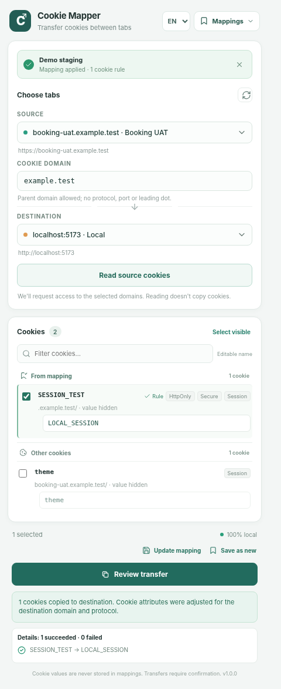

# Cookie Mapper

**Copy and rename selected cookies between development tabs, with saved mappings and explicit confirmation.**

[Leer en español](README.es.md) · [Privacy](PRIVACY.md) · [Security](SECURITY.md) · [Contributing](CONTRIBUTING.md)

> **For development and QA environments you are authorized to access.** Cookie values can grant account access. Never transfer someone else's authentication cookies or copy them to untrusted sites.



## Features

- Choose source and destination tabs in Microsoft Edge or other Chromium browsers.
- Read host and parent-domain cookies, including `HttpOnly` cookies when the extension has site permission.
- Select cookie names to copy and set destination names (aliases).
- Save reusable mapping profiles and rules: `https://app-{env}.example.test/**` → `http://localhost:5173/**`.
- Match profiles to open tabs, **suggest** an applicable profile without silently applying it.
- List mapped cookies first, preserve the rule order, and show unmapped cookies separately.
- Preview potential overwrites before **explicitly confirming** any write.
- Choose **English or Spanish**, automatically detected from browser UI locale with an in-popup ES/EN override.
- Process locally with no backend, analytics, remote scripts, or persisted cookie values.

## Installation (unpacked extension)

1. Download the ZIP from a [GitHub Release](../../releases) once available, or build from source.
2. Unzip the **installable package**; its root must contain `manifest.json`.
3. Open `edge://extensions` (or `chrome://extensions`), enable Developer mode, click **Load unpacked**, and select the unpacked folder.
4. Open the source and destination tabs, click Cookie Mapper and follow **Read → Select/Rename → Review → Confirm**.

**Upgrading from v0.6:** replace the files in the **same unpacked folder** and reload the extension. Mappings use the existing `cookieMapperProfilesV03` key, so no destructive migration is required. Installing into a new folder may assign a new extension ID and won't carry over storage automatically.

## Build from source

Requirements: Node.js 20+, TypeScript (installed by npm), Python 3; for tests, Playwright and Chromium.

```sh
npm install
npm run check
npm run build
python3 scripts/package_release.py
```

The installable extension is in `dist/`, and a ZIP suitable for a GitHub Release is in `release/`. No Node.js installation is needed by end users.

**Windows:** if `python3` is not available, use `py -3 scripts/package_release.py` (and `py -3 -m pip` for Python packages).

To run the regression suite:

```sh
python3 -m pip install playwright==1.56.0
python3 -m playwright install chromium
npm test
```

## Mapping example

| Setting | Example |
|---|---|
| Source pattern | `https://app-{env}.example.test/**` |
| Cookie domain | `example.test` |
| Destination pattern | `http://localhost:5173/**` |
| Rule | `SESSION_TEST` → `LOCAL_SESSION` |

Templates support `{variables}`, `*`, and `**`. Advanced source patterns can use `re:` with named capture groups. Saved mappings persist only configuration, **not cookie values**. The destination always stays a URL template.

## Permissions and limits

The `tabs`, `cookies`, and `storage` permissions are needed for tab selection, cookie operations, and settings. Optional HTTP(S) host permissions are requested for chosen domains on demand. Parent-domain cookies can be accessed with permission to the parent domain. Partitioned cookies are intentionally skipped. Cross-domain copies may not work with host-bound sessions, and `Secure`/`SameSite` may be adjusted when copying to HTTP. See [security](SECURITY.md) and [privacy](PRIVACY.md).

## Release readiness

See [publishing checklist](docs/PUBLISHING.md) and [store listing drafts](docs/STORE_LISTING.md). GitHub Actions checks the build/tests. Tagging `v1.0.0` creates a ZIP release when the repository workflow is enabled. The demo screenshot contains **synthetic cookies and example domains**, not production credentials.

## License

Cookie Mapper source is licensed under [MIT](LICENSE). Bundled Lucide icons remain licensed under [ISC](LICENSE-LUCIDE.txt).
